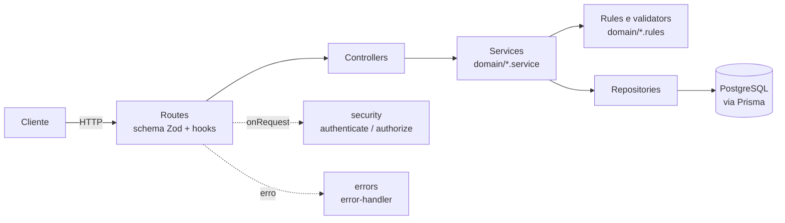

# Arquitetura

A API é um monólito em camadas (Controller → Service → Repository) sobre **Fastify 5**, **Zod 4**, **Prisma 6** e **PostgreSQL**.
A regra de negócio vive no domínio e não conhece HTTP nem Prisma.

## Visão geral

| Camada | Pasta | Responsabilidade | Não faz |
| --- | --- | --- | --- |
| Routes | `src/routes` | Declara endpoint, schema Zod (entrada e saída), autenticação e autorização por papel | Regra de negócio |
| Controllers | `src/controllers` | Extrai dados da requisição, chama o service, monta o envelope de resposta | Regra de negócio, acesso a dados |
| Domínio | `src/domain/<módulo>` | `*.service.ts` orquestra o caso de uso; `*.rules.ts` concentra as regras; `validators/` valida valores (puros) | Conhecer HTTP ou Prisma |
| Repositories | `src/repositories` | Único código que fala com o Prisma, atrás de interfaces; devolve tipos próprios | Regra de negócio, decidir transação |
| Persistência | `src/persistence` | Cliente Prisma único, `executarEmTransacao` | |
| Segurança | `src/security` | Hash de senha, JWT, `authenticate`, `authorize` | |
| Erros | `src/errors` | Erros tipados (`AppError`), mapeamento e handler global | |
| Config | `src/config` | Leitura e validação do ambiente, logger | |

Módulos de domínio: `usuario`, `auth`, `organizacao`, `lote`, `equipamento`, `relatorio`.

## Ciclo de uma requisição

1. **Route** recebe a chamada. O hook `onRequest` roda `authenticate` (JWT) e depois `authorize` (papel). Falhas viram 401/403 **antes** da validação do corpo.
2. O **schema Zod** valida body, params e query (400 com `details` por campo se inválido).
3. O **controller** chama o **service**.
4. O **service** carrega dados pelos repositórios, chama as **rules** e persiste. Se precisar de atomicidade, abre `executarEmTransacao`.
5. A resposta passa pelo schema de saída (campos fora do contrato, como hash de senha, nunca saem) e pelo envelope `{ data, message?, meta? }`.
6. Qualquer erro lançado em qualquer ponto cai no **handler global** (`src/errors`), que o converte no formato padrão sem vazar detalhes internos.

## Domínio

| Onde | Contém | Regras |
| --- | --- | --- |
| `validators/` | `validarX(valor)` que devolve `{ valido: true }` ou `{ valido: false, mensagem }` | Puras: sem banco, sem relógio global (a data atual é parâmetro), sem lançar erro |
| `<módulo>.rules.ts` | Regras nomeadas (`exigirX`, `garantirX`, `protegerX`) | Recebem dados já carregados e lançam erro tipado |
| `<módulo>.service.ts` | Caso de uso | Busca, aplica regras, persiste e **decide a transação** |

Erros de domínio (`src/errors/app-error.ts`): `RegraDeNegocioError` 400, `UnauthorizedError` 401, `ForbiddenError` 403, `NotFoundError` 404, `ConflictError` 409. Veja as regras em [regras-de-negocio.md](regras-de-negocio.md).

## Persistência

- A instância do Prisma existe em um só lugar (`src/persistence/prisma.ts`). Só `src/repositories` e `src/persistence` podem importá-la; `npm run check:arquitetura` falha se alguém violar (também limita o uso de `@prisma/client` a poucos pontos, como `domain/shared/enums.ts`).
- Os repositórios devolvem os tipos de `src/repositories/entities.ts`, não os modelos do Prisma.
- Contrato padrão (`CrudRepository`, em `base.repository.ts`): `findById`, `findAll`, `create`, `update`, `delete` e `count`, todos com `tx?` opcional como último parâmetro. `update`/`delete` de id inexistente lançam P2025 (vira 404).
- Leituras específicas têm nome próprio (`listarComResumo`, `findDetalheById`, `atualizarComVersao`...). `RelatorioRepository` só tem consultas agregadas.
- `hashSenha` só sai de `UsuarioRepository.findCredencialByUsuario`, usado no login. Todos os outros métodos usam `select` explícito sem o hash.

### Transações

O **service** decide e registra o motivo em comentário `Transação: SIM/NÃO`. Use `executarEmTransacao` quando houver (1) mais de uma escrita que precisa ser atômica ou (2) sequência "ler → decidir → gravar" que a concorrência poderia invalidar. No caso (2) use `isolamento: 'serializavel'`: um conflito vira 409 e o cliente pode repetir. Não use em escrita única nem quando o banco já garante a invariante (constraint `unique`, *optimistic locking* por `version`).

| Operação | Transação | Motivo |
| --- | --- | --- |
| Cadastrar equipamento | Sim (serializável) | Posição/código sequencial e status do lote mudam juntos |
| Movimentar equipamento | Sim | Status e histórico atômicos (concorrência coberta por `version`) |
| Rebaixar ou remover administrador | Sim (serializável) | Contar administradores e alterar precisam ser atômicos |
| Alterar estado físico | Não | Escrita única com `version` |
| Criar usuário, organização, lote | Não | Escrita única; unicidade na constraint |
| Login, relatórios, consultas | Não | Leitura (último acesso é informativo) |

### Modelo de dados

Definido em `prisma/schema.prisma` (tabelas `usuarios`, `organizacoes`, `lotes`, `equipamentos`, `movimentacoes`, `contratos`). `Equipamento` e `Lote` têm `version` para *optimistic locking*. O modelo `Contrato` existe no banco, mas **ainda não tem endpoint**. As migrações ficam em `prisma/migrations` e são aplicadas com `npm run db:migrate` (dev) ou `npm run db:migrate:deploy` (produção).

## Como evoluir

- **Novo caso de uso:** regra em `*.rules.ts`, orquestração no `*.service.ts`, acesso a dados no repositório, schema em `src/schemas`, rota e controller finos. Decida e comente a transação.
- **Nova rota protegida:** registre `authorize(GRUPOS_DE_ACESSO.X)` em `onRequest`. Se precisar de um grupo novo, crie-o em `src/security/roles.ts` e atualize a matriz em [autenticacao.md](autenticacao.md) e o teste `tests/integration/autorizacao.test.ts`.
- **Nova variável de ambiente:** `src/config/env.parser.ts` (validação e padrão), `.env.example` e a tabela do README.
- **Mudança de schema do banco:** edite `prisma/schema.prisma`, rode `npm run db:migrate`, revise o SQL gerado e comite a migração.
