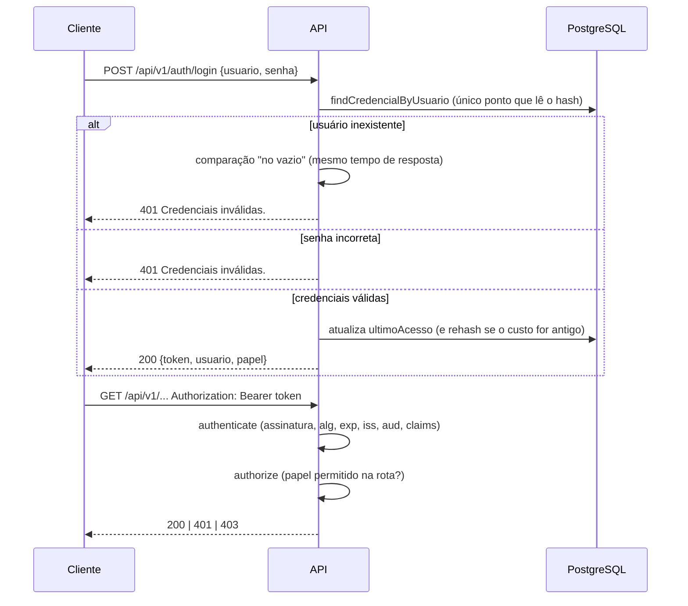

# Autenticação e autorização

## Fluxo de login e uso do token

Usuário inexistente e senha errada recebem **a mesma resposta** (mensagem e tempo), para não revelar quais usuários existem.

## Senhas

- Só o hash **bcrypt** (custo 12) é armazenado. O salt vem embutido no hash; não há coluna de salt.
- Hashes de custo menor continuam válidos e são regravados no próximo login bem-sucedido.
- **Política**, aplicada ao criar ou alterar senha (não ao logar): mínimo de 8 caracteres, com maiúscula, minúscula, número e símbolo; máximo de 72 **bytes** (limite do bcrypt); não pode conter o nome de usuário nem estar na lista de senhas comuns. Código: `src/domain/validators/senha.ts`.
- Qualquer usuário troca a própria senha em `PATCH /api/v1/usuarios/me/senha`.

## JWT (stateless)

- Assinatura **HS256** com `JWT_SECRET`. Algoritmo fixo: tokens com outro `alg` (inclusive `none`) são recusados.
- Claims emitidos: `sub` (id do usuário), `usuario`, `papel`, `jti`, `iat`, `exp`, `iss`, `aud` (tipos em `src/types/auth.ts`).
- Um token é rejeitado com **401 genérico** se a assinatura, o algoritmo, o `exp`, o `iss`, o `aud` ou qualquer claim obrigatório (`sub`, `usuario`, `papel`) estiver ausente ou inválido. O motivo não é revelado ao cliente.
- Configuração em `src/security/jwt.ts`; validação extra em `src/security/authenticate.ts`. Validade, emissor e público vêm de `JWT_EXPIRES_IN`, `JWT_ISSUER` e `JWT_AUDIENCE`.
- Não há sessão em banco. **Limitação conhecida:** como não há consulta ao banco por requisição, o token vale até expirar mesmo que o usuário seja removido ou tenha o papel alterado. Em produção use `JWT_EXPIRES_IN` curto. Para revogação imediata o caminho é refresh token ou lista de revogação por `jti` (o `jti` já é emitido para isso).

## Autorização por papel (RBAC)

Papéis: `ADMINISTRADOR`, `OPERADOR_CADASTRO`, `GESTOR_ALMOXARIFADO`, `AUDITOR`. Os grupos ficam em `src/security/roles.ts` (`GRUPOS_DE_ACESSO`) e são aplicados em `onRequest`, ou seja, **antes** da validação do corpo.

| Recurso | ADMINISTRADOR | OPERADOR_CADASTRO | GESTOR_ALMOXARIFADO | AUDITOR |
| --- | :-: | :-: | :-: | :-: |
| Login, health | público | público | público | público |
| Trocar a própria senha | ✅ | ✅ | ✅ | ✅ |
| Criar, editar e remover usuários | ✅ | ❌ | ❌ | ❌ |
| Listar organizações | ✅ | ✅ | ✅ | ✅ |
| Criar organização | ✅ | ✅ | ❌ | ❌ |
| Listar e consultar lotes | ✅ | ✅ | ✅ | ✅ |
| Criar lote | ✅ | ❌ | ✅ | ❌ |
| Cadastrar, movimentar e alterar estado de equipamento | ✅ | ✅ | ✅ | ❌ |
| Rastrear equipamento | ✅ | ✅ | ✅ | ✅ |
| Relatórios | ✅ | ❌ | ✅ | ✅ |

Regras adicionais no serviço (`usuario.rules.ts`): `PUT /usuarios/:id` aceita não administradores **apenas sobre o próprio usuário**, e eles só podem alterar a própria senha (nome de usuário e papel exigem administrador). O sistema também nunca fica sem administrador (veja [regras-de-negocio.md](regras-de-negocio.md)).

A matriz acima é verificada automaticamente por `tests/integration/autorizacao.test.ts`.

## Logs e dados sensíveis

Tokens, senhas, hashes, cookies, headers e query strings não são registrados (serializador de requisição enxuto e `redact` em `src/config/logger.ts`). Erros do Prisma são logados só com tipo e código, porque a mensagem original traz os valores da consulta. Respostas de erro 500 são genéricas.

## Ainda não implementado

CORS, limite de tentativas de login (*rate limit*), HTTPS e revogação imediata de token. Em produção, coloque a API atrás de um proxy reverso com TLS e, se necessário, limitação de taxa.
